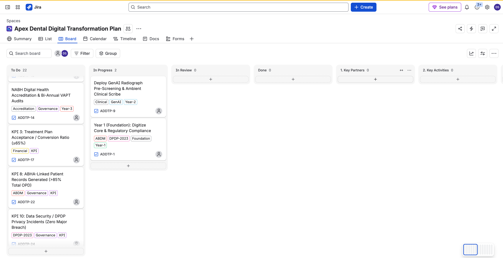
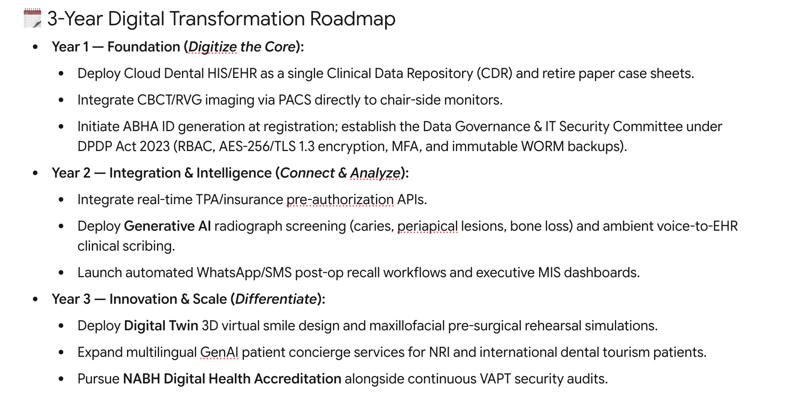
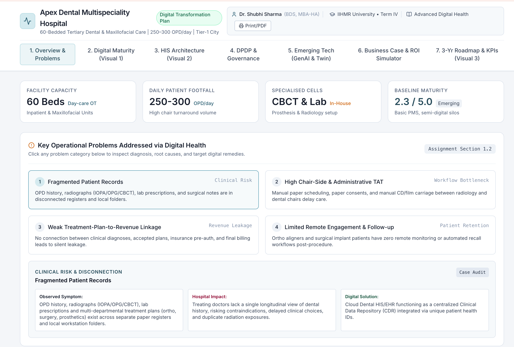

# Apex-Dental-Multispeciality-Hospital-Digital-Transformation-Plan

# Digital Transformation Plan & Jira Business Model Canvas: Apex Dental Multispeciality Hospital

## Project Overview

This repository houses a comprehensive **Digital Transformation Plan**, **Interactive Financial & Maturity Dashboard**, and **Jira-based Business Model Canvas (BMC) & 3-Year Implementation Roadmap** designed for **Apex Dental Multispeciality Hospital**—a 60-bedded tertiary dental and maxillofacial care hospital in a Tier-1 Indian city handling 250–300 daily OPD visits.

Developed as part of **MBA – Healthcare Analytics (Advanced Digital Health)** coursework at **IIHMR University**, this project bridges healthcare regulatory desk research (**India's DPDP Act, 2023** and **Ayushman Bharat Digital Mission – ABDM/ABHA**) with agile product management in **Jira Software** and financial ROI modeling.

## Key Objectives & Desk Research Highlights

1. **Regulatory & Policy Desk Research (Government of India Sources):**
   * **Digital Personal Data Protection (DPDP) Act, 2023:** Operationalized data fiduciary obligations for sensitive dental/maxillofacial records, including purpose limitation, data minimization, verifiable digital timestamped patient consent, right to erasure, and breach notification governance.
   * **Ayushman Bharat Digital Mission (ABDM) & ABHA:** Designed FHIR R4-compliant interoperability workflows to onboard walk-in patients with 14-digit **ABHA (Ayushman Bharat Health Account)** IDs and exchange consent-linked health records across the national digital health ecosystem.

2. **Digital Maturity Assessment:**
   * Benchmarked baseline readiness at **2.3 / 5.0** (*Foundational/Emerging*) across Technology (2/5), Data (2/5), Workforce (2/5), Organizational (3/5), and Financial (3/5) dimensions, targeting **4.6 / 5.0** by Year 3.

3. **Business Case & 3-Year ROI Analysis:**
   * Evaluated the core investment in a **Cloud-Based Dental HIS/EHR with PACS & AI-Imaging**, demonstrating a **~14-month payback period** and **~128% 3-Year ROI**.

4. **Agile Execution in Jira Software:**
   * Translated strategic findings into a 9-block **Business Model Canvas (BMC)** on a Jira Kanban Board alongside a **3-Year Phased Roadmap (Epics & Tasks)** and **10 Key Performance Indicators (KPIs)**.

## Repository Structure

```
├── README.md                                       # Project documentation & setup guide
├── LICENSE                                         # MIT License
├── assets/                                         # Folder for Jira & Dashboard screenshots
│   ├── jira-bmc-board.png                          # Screenshot of 9-column Business Model Canvas in Jira
│   ├── jira-3yr-timeline.png                       # Screenshot of Year 1–3 Epics on Jira Timeline
│   └── dashboard-roi-simulator.png                 # Screenshot of interactive HTML Dashboard & ROI model
├── apex_dental_digital_transformation_dashboard.html # Interactive HTML/JS dashboard (Maturity Radar, HIS Architecture & What-If ROI Simulator)
├── apex_dental_bmc_roadmap_kpis_combined.csv       # Combined 50-item Jira bulk import (26 BMC items + 3 Epics + 11 Tasks + 10 KPIs)
├── apex_dental_roadmap_kpis_jira.csv               # Standalone 24-item Jira CSV for 3-Year Roadmap & KPIs
└── Apex_Dental_Digital_Transformation_Plan.docx    # Full strategic report & architecture documentation
```

## Screenshots & Visual Previews

> **How to add your screenshots on GitHub:**
> 1. Create a folder named `assets` in the root of your GitHub repository (click **Add file** > **Create new file**, type `assets/.gitkeep`, and commit).
> 2. Take screenshots of your Jira Kanban BMC Board, Jira 3-Year Timeline, and the HTML Dashboard, and save them as `jira-bmc-board.png`, `jira-3yr-timeline.png`, and `dashboard-roi-simulator.png`.
> 3. Upload all three images into the `assets/` folder—they will automatically render below!

### 1. Jira Software — 9-Block Business Model Canvas (Kanban Board)

*9-column Kanban layout organizing Key Partners, Key Activities, Key Resources, Value Propositions, Customer Relationships, Channels, Customer Segments, Cost Structure, and Revenue Streams.*

### 2. Jira Software — 3-Year Digital Transformation Timeline

*Phased Epics and implementation tasks across Year 1 (Core & DPDP/ABHA), Year 2 (TPA APIs & GenAI), and Year 3 (Digital Twin & NABH Accreditation).*

### 3. Interactive Dashboard — Digital Maturity & What-If ROI Simulator

*7-module interactive analytics dashboard featuring the Digital Maturity Radar, clickable HIS/ABDM Architecture diagram, KPI tracker, and dynamic ROI calculator.*

## Financial Business Case & ROI Summary

* **Priority Initiative:** Cloud-Based Dental HIS/EHR + DICOM PACS + ABDM Gateway + AI-Imaging Module

| Financial Parameter | Estimate (INR) | Notes / Breakdown |
| :--- | :--- | :--- |
| **Year 1 Implementation Capex** | **₹55 Lakh** | Cloud HIS/EHR licensing, PACS & ABDM integration, data migration, training |
| **Annual Recurring Opex** | **₹12 Lakh / yr** | Cloud hosting, vendor support, MFA/encryption & bi-annual VAPT audits |
| **Benefit 1: Revenue Leakage & Claims** | **+₹28 Lakh / yr** | Eliminating unbilled chair procedures & cutting TPA settlement TAT (<7 days) |
| **Benefit 2: Chair & OT Utilization** | **+₹22 Lakh / yr** | Cutting registration-to-consultation TAT from 42 mins to <18 mins |
| **Benefit 3: AI & Digital Twin Upsell** | **+₹18 Lakh / yr** | Boosting treatment-plan acceptance ratio from 48% to ≥65% |
| **Total Gross Annual Benefit** | **₹68 Lakh / yr** | Sum of operational, financial, and clinical conversion gains |
| **Net Annual Benefit** | **₹56 Lakh / yr** | Gross Annual Benefit minus ₹12 Lakh recurring Opex |
| **Payback Period** | **~1 Year 2 Months** | Break-even achieved at Month 14 |
| **Estimated 3-Year ROI** | **~128%** | $\frac{(3 \times ₹56\text{L}) - ₹55\text{L}}{₹55\text{L}} \times 100 \approx 128\%$ |

## 3-Year Digital Transformation Roadmap

* **Year 1 — Foundation (*Digitize the Core*):**
  * Deploy Cloud Dental HIS/EHR as a single Clinical Data Repository (CDR) and retire paper case sheets.
  * Integrate CBCT/RVG imaging via PACS directly to chair-side monitors.
  * Initiate ABHA ID generation at registration; establish the Data Governance & IT Security Committee under DPDP Act 2023 (RBAC, AES-256/TLS 1.3 encryption, MFA, and immutable WORM backups).

* **Year 2 — Integration & Intelligence (*Connect & Analyze*):**
  * Integrate real-time TPA/insurance pre-authorization APIs.
  * Deploy **Generative AI** radiograph screening (caries, periapical lesions, bone loss) and ambient voice-to-EHR clinical scribing.
  * Launch automated WhatsApp/SMS post-op recall workflows and executive MIS dashboards.

* **Year 3 — Innovation & Scale (*Differentiate*):**
  * Deploy **Digital Twin** 3D virtual smile design and maxillofacial pre-surgical rehearsal simulations.
  * Expand multilingual GenAI patient concierge services for NRI and international dental tourism patients.
  * Pursue **NABH Digital Health Accreditation** alongside continuous VAPT security audits.

## How to Use the Artifacts in This Repository

### 1. Launch the Interactive Dashboard
1. Download `apex_dental_digital_transformation_dashboard.html`.
2. Open the file directly in any modern web browser (Chrome, Edge, Safari, Firefox)—no local server or build step required.
3. Explore all 7 interactive modules, inspect the HIS/ABDM architecture nodes, filter the 10 KPIs, and adjust sliders in the **What-If ROI Simulator**.

### 2. Import the Business Model Canvas & Roadmap into Jira Software
1. Create a **Team-managed Kanban project** in Jira Software (e.g., `Apex Dental Digital Transformation`).
2. Configure **9 Board Columns** representing the Business Model Canvas:
   * `1. Key Partners` | `2. Key Activities` | `3. Key Resources` | `4. Value Propositions` | `5. Customer Relationships` | `6. Channels` | `7. Customer Segments` | `8. Cost Structure` | `9. Revenue Streams`
3. Navigate to **Settings (⚙️) > System > External System Import > CSV** and upload `apex_dental_bmc_roadmap_kpis_combined.csv`.
4. Map `Summary`, `Issue Type`, `Description`, and `Labels` to import all **50 work items** (26 BMC cards, 3 Yearly Epics, 11 Implementation Tasks, and 10 KPI Stories).
5. Use the **Board** view to visualize the Business Model Canvas and the **Timeline** view to manage the 3-year rollout.


## Author

**Dr. Shubhi Sharma** (BDS, MBA – Healthcare Administration)  
*IIHMR University | Specialization: Healthcare Analytics & Digital Health*
